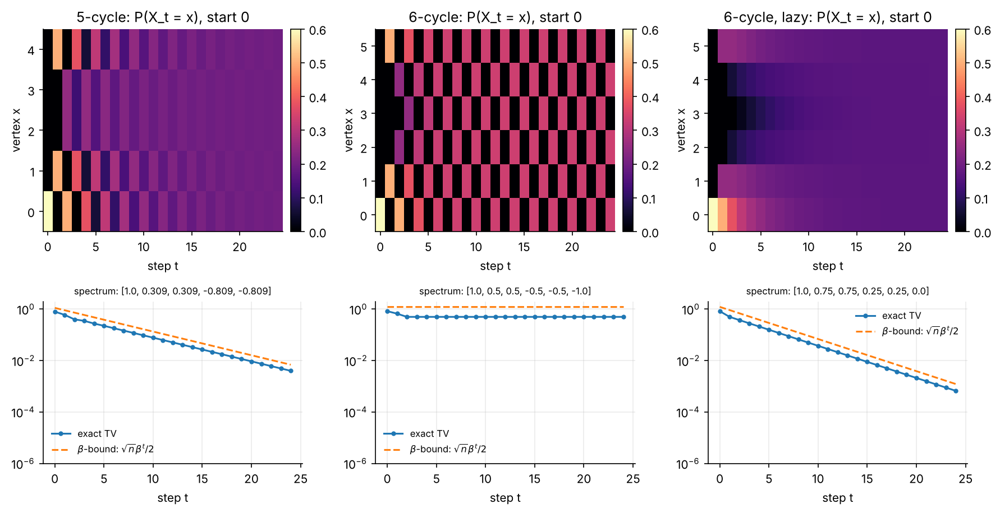
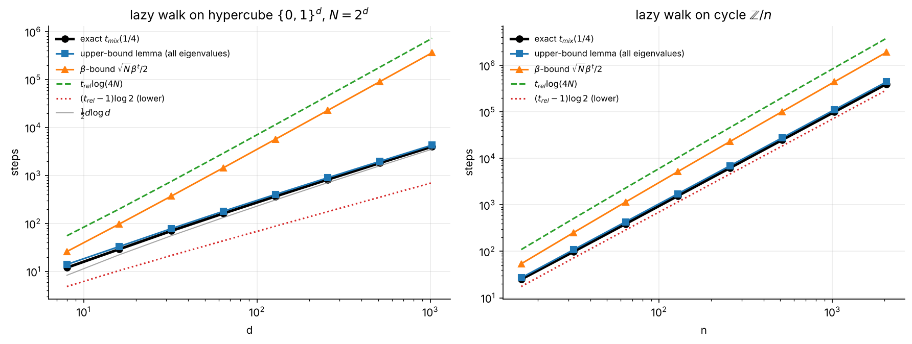
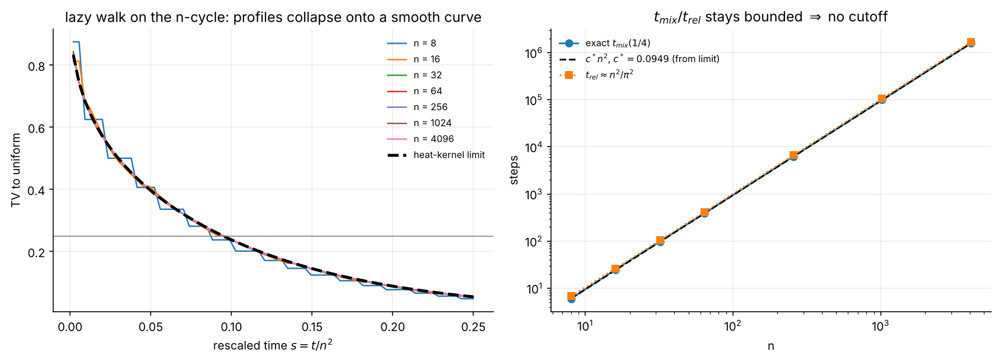
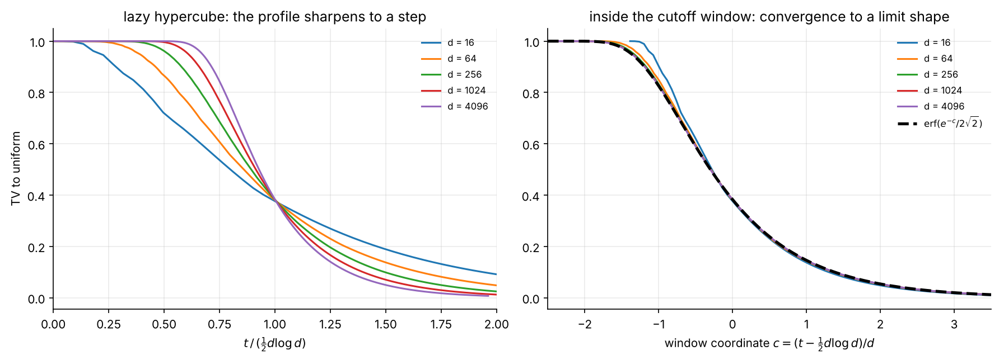
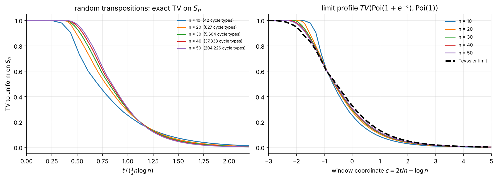
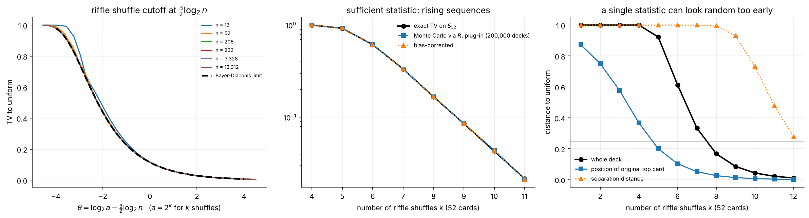
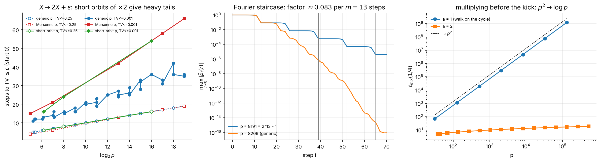
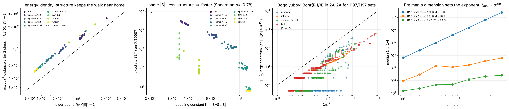

# cayley-mixing

**How many steps does a random walk on a group need before it forgets where it started?**
This repository answers that question *exactly* — not by simulation, but by Fourier analysis,
spectral theory and symmetry reduction — for walks on cycles, hypercubes, the symmetric group,
noisy linear-congruential generators, and Cayley graphs built from sets with additive structure.
State spaces go up to 2^4096 points (hypercube), 50! ≈ 3·10^64 (random transpositions) and
13,312! (riffle shuffles), and every fast method is checked against brute force.

```
pip install -e .            # numpy, scipy, matplotlib
pytest -q                   # 32 tests, ~1 s
python experiments/run_all.py   # all 8 experiments, ~90 s on one core
```

---

## Headline results

| # | Question | Answer (all numbers exact unless marked) |
|---|----------|-------------------------------------------|
| E1 | Does the walk on a cycle always become uniform? | Only if the graph is non-bipartite. On the 6-cycle the total-variation distance (TV) is stuck at 1/2 forever; holding with probability 1/2 fixes it. |
| E2 | Is the classical bound ‖Pᵗp − u‖₁ ≤ √N βᵗ a good mixing-time estimate? | On the cycle it is off by a log factor (4.8× at n = 2048). On the hypercube it is off by a factor ~d/log d: **363,941 predicted vs 4,009 true steps at d = 1024 (91×)**. Diaconis' upper-bound lemma, which uses every eigenvalue, is within 8% (hypercube) and 11% (cycle). |
| E3 | How does the cycle mix? | t_mix(1/4) = **0.09487 n²** (fitted exponent 1.9987), matching a heat-kernel limit derived in closed form. The profile converges to a smooth curve: **no cutoff**. |
| E4 | Hypercube? | **Cutoff** at ½ d log d with window ≈ 1.28 d. Exact up to N = 2^4096; the profile inside the window matches erf(e^{−c}/2√2) to 7·10⁻⁴. |
| E5 | Random transpositions on S_n? | Exact TV on S_50 by lumping 50! states into 204,226 cycle types. t_mix = 104 vs ½ n log n = 97.8; converges to Teyssier's (2020) Poisson limit profile. |
| E6 | How many riffle shuffles mix a deck? | Bayer–Diaconis table reproduced exactly (7 shuffles of 52 cards: TV = 0.3341). Cutoff at (3/2) log₂ n verified to n = 13,312. **The position of the top card looks random after 5 shuffles (TV 0.20) while the deck is at TV 0.92.** |
| E7 | Noisy LCG X → aX + ε mod p | a = 1 needs **1.2·10⁹** steps at p = 131,071; a = 2 needs **17**. New observation: primes where 2 has small multiplicative order (Mersenne, Fermat, 73) have a heavy tail — reaching TV ≤ 10⁻³ at p ≈ 2¹⁹ takes **66 steps vs 35**. Explained by a Fourier "staircase". |
| E8 | Does additive structure slow mixing? | Exact identity: P(X₄ = 0) = E(S)/\|S\|⁴ (additive energy), verified to 1.7·10⁻¹⁵. Same-size generating sets: AP (K = 2.0) → 87,696 steps; random (K = 12.0) → 6 steps. The exponent is set by the dimension of the progression: t_mix ∼ p^{2/d} (fitted 2.00, 0.91, 0.72 for d = 1, 2, 3). Bogolyubov's lemma checked on 1,197 sets: always holds. |

---

## Background in one page

A **Cayley graph** Cay(G, S) has the elements of a finite group G as vertices and joins x to xs
for each generator s ∈ S. The simple random walk on it is the Markov chain
X_{t+1} = X_t · s_{t+1} with s_t i.i.d. uniform on S, whose transition matrix is T = A/|S|.
If S = S⁻¹, the graph is connected (S generates G) and not bipartite, then Pᵗ → uniform.

**Spectral view.** T is symmetric, so it has an orthonormal eigenbasis with eigenvalues
1 = λ₁ > λ₂ ≥ … ≥ λ_N > −1. Writing β = max_{j≥2} |λ_j|, the classical argument gives

  ‖Tᵗ p − u‖₁ ≤ √N βᵗ.   (β-bound)

**Fourier view (abelian G).** Every character χ_r is an eigenfunction, with eigenvalue
μ̂(r) = Σ_s μ(s) χ_r(s). Plancherel then gives an *identity*, not just a bound:

  χ²(t) := N Σ_x (p_t(x) − 1/N)² = Σ_{r≠0} |μ̂(r)|^{2t}.   (★)

Since TV ≤ ½√χ², (★) yields Diaconis' upper-bound lemma. The β-bound is what you get by
replacing every |μ̂(r)| with the worst one — which is fine when one eigenvalue dominates
(cycle) and catastrophic when the second eigenvalue has multiplicity d out of 2^d (hypercube).

**Cutoff.** A family of chains has *cutoff* if TV drops from ≈1 to ≈0 in a window that is
o(t_mix). A necessary condition is t_mix / t_rel → ∞, where t_rel = 1/(1 − β) is the
relaxation time. On the cycle t_mix/t_rel → 0.936 (no cutoff); on the hypercube it grows like
log d (cutoff).

**Distances used.** TV = ½ Σ|p − u| ∈ [0, 1] (= ½ the L¹ norm); χ² as above; separation
max_x(1 − N p(x)) ≥ TV. Mixing time t_mix(ε) = min{t : TV(p_t, u) ≤ ε}, ε = 1/4 by default.

---

## How the exact computations work

| Technique | Where | What it buys |
|-----------|-------|--------------|
| Walk as a sum of permutations, no matrix | `walk.py` | One step costs O(\|G\|·\|supp μ\|); works for any finite group. |
| Characters + FFT | `spectral.py` | Exact law p_t = IFFT(FFT(μ)ᵗ) in O(N log N) *for any t* — this is what makes t ≈ 10⁹ on Z/131071 cheap. Mixing times by bisection (TV is non-increasing in t). |
| Lumping by symmetry | `lumped.py` | If μ is invariant under a symmetry group, Pᵗ(id, ·) is constant on orbits, and so is the uniform law, so TV on the big space equals TV on orbit masses. Hypercube → Hamming weight (d + 1 states). Random transpositions → cycle types (p(n) states), with the exact merge/split transition law derived in the docstring. |
| Sufficient statistic | `shuffles.py` | After k GSR riffles, P(σ) = C(2^k + n − R(σ), n)/2^{kn} depends only on the number of rising sequences R, and #{σ : R = r} is an Eulerian number, so TV over 52! decks is a 52-term sum, done in exact rational arithmetic (and in a log-space float version for n ≈ 10⁴, validated against the rationals to 10⁻⁹). |
| Additive combinatorics by FFT | `additive.py` | Sumsets, iterated sumsets 2A − 2A, additive energy, large spectrum and Bohr sets on Z/N. |

**Verification** (`tests/test_core.py`, 32 tests): character eigenvalues = dense eigenvalues
(including non-symmetric measures); characters are eigenfunctions; FFT laws = direct evolution;
identity (★) holds to rounding; both bounds dominate TV at every t; hypercube lumping = full walk on
Z₂⁷ for two holding rules; the cycle-type chain = full walk on S₄, S₅, S₆ (and its rows sum to 1 and
it fixes 1/z_λ); the Bayer–Diaconis formula = brute-force convolution of the GSR measure on S₃–S₅;
the published 52-card table to 3 decimals; the exact top-card law = brute force; Monte Carlo rising
sequences = exact law; energy via FFT = brute force over A⁴; Bogolyubov on random and structured sets.

---

## Experiments

### E1 — Small cycles: periodicity and the lazy fix
`experiments/e01_small_cycles.py` → `results/figures/e01_small_cycles.png`

The 5-cycle has spectrum {1, 0.309, 0.309, −0.809, −0.809}, so β = 0.809 and the walk mixes in 5
steps. The 6-cycle has −1 in its spectrum (it is bipartite): mass alternates between even and odd
vertices and TV stays at exactly 1/2. Holding with probability 1/2 maps every eigenvalue λ to
(1 + λ)/2 ∈ [0, 1], giving β = 0.75 and mixing in 4 steps. The β-bound is valid but ~2× loose here.



### E2 — How tight is the β-bound?
`experiments/e02_bound_tightness.py`

| hypercube d | exact t_mix | upper-bound lemma | β-bound | β / exact |
|---:|---:|---:|---:|---:|
| 8 | 12 | 14 | 26 | 2.2× |
| 64 | 162 | 180 | 1,453 | 9.0× |
| 256 | 825 | 900 | 22,846 | 27.7× |
| 1024 | 4,009 | 4,315 | 363,941 | **90.8×** |

| cycle n | exact | upper-bound lemma | β-bound | β / exact |
|---:|---:|---:|---:|---:|
| 64 | 389 | 432 | 1,151 | 2.96× |
| 512 | 24,870 | 27,642 | 101,258 | 4.07× |
| 2048 | 397,917 | 442,265 | 1,914,692 | 4.81× |

On the hypercube the lazy walk has eigenvalue 1 − j/d with multiplicity C(d, j). The √N = 2^{d/2}
prefactor forces the β-bound to wait ~(ln 2/2)d² steps, while the truth is ~½ d log d. The
upper-bound lemma, summing C(d, j)(1 − j/d)^{2t} in log space, stays within 8% of exact for every d (and within 11% on the cycle).
Lesson: **β alone tells you the decay rate, not the mixing time; the multiplicity of the slow
modes matters as much as their speed.**



### E3 — The cycle: diffusive mixing and no cutoff
`experiments/e03_cycle_no_cutoff.py`

At t = s·n² the eigenvalues satisfy λ_kᵗ → e^{−π²k²s}, so X_t/n converges to a wrapped Gaussian
f_s(x) = 1 + 2Σ_k e^{−π²k²s} cos 2πkx, and TV(s n²) → TV_∞(s) = ½∫|f_s − 1|. Solving TV_∞(c*) = 1/4
gives **c* = 0.09487**; the exact t_mix/n² for n = 256, 1024, 4096 is 0.09488, 0.09487, 0.09487.
The sup-distance between the exact profile and the limit is below 10⁻⁴ by n = 256. Because the
limit is smooth, there is no cutoff, consistent with t_mix/t_rel → c*π² = 0.936.



### E4 — The hypercube: cutoff, computed exactly for N = 2^4096
`experiments/e04_hypercube_cutoff.py`

| d | t_mix | t_mix / (½ d log d) | (t_{1/4} − t_{3/4}) / d | t_mix / t_rel | sup \|TV − limit\| |
|---:|---:|---:|---:|---:|---:|
| 16 | 29 | 1.307 | 1.125 | 1.81 | 0.089 |
| 256 | 825 | 1.162 | 1.270 | 3.22 | 0.008 |
| 4096 | 18,879 | 1.108 | 1.282 | 4.61 | 0.0007 |

The window converges to 1.2837·d, which is exactly what the limit shape erf(e^{−c}/2√2) predicts
(c_{1/4} − c_{3/4} = 0.4505 + 0.8332). That limit comes from a short heuristic in the script's
docstring: at t = ½ d log d + c d the Hamming weight is e^{−c} standard deviations from d/2 and
already Gaussian.



### E5 — Random transpositions on S_n, exact for n = 50
`experiments/e05_random_transpositions.py`

Composing with a transposition (i j) merges the cycles containing i and j, or splits their common
cycle according to the distance from i to j. That gives an exact chain on cycle types:

| n | \|S_n\| | cycle types | t_mix(1/4) | ½ n log n | sup \|TV − Teyssier limit\| |
|---:|---:|---:|---:|---:|---:|
| 10 | 3.6·10⁶ | 42 | 12 | 11.5 | 0.149 |
| 30 | 2.7·10³² | 5,604 | 54 | 51.0 | 0.061 |
| 50 | 3.0·10⁶⁴ | 204,226 | 104 | 97.8 | 0.039 |

The distance to Teyssier's limit TV(Poisson(1 + e^{−c}), Poisson(1)), with t = (n/2)(log n + c),
decreases steadily with n. (Intuition: e^{−c} cards are still untouched, on top of the Poisson(1)
fixed points of a uniform permutation.)



### E6 — Riffle shuffles and statistics that lie
`experiments/e06_riffle_shuffles.py`

| shuffles k (52 cards) | 4 | 5 | 6 | **7** | 8 | 9 | 10 | 12 |
|---|---|---|---|---|---|---|---|---|
| TV | 1.000 | 0.924 | 0.614 | **0.334** | 0.167 | 0.085 | 0.043 | 0.011 |
| separation | 1.000 | 1.000 | 1.000 | 1.000 | 0.996 | 0.932 | 0.732 | 0.278 |
| top-card position TV | 0.367 | 0.200 | 0.103 | 0.052 | 0.026 | 0.013 | 0.007 | 0.002 |

- **Cutoff.** With a-shuffles (a = 2^k, any integer a allowed), TV as a function of
  θ = log₂a − (3/2)log₂n converges to the Bayer–Diaconis limit 1 − 2Φ(−2^{−θ}/(4√3)). The sup error
  falls from 0.10 (n = 13) to 10⁻⁴ (n = 13,312); TV ≤ 1/4 needs 8, 11, 14, 17, 20 shuffles for
  n = 52, 208, 832, 3328, 13312, i.e. ⌊(3/2)log₂n⌋ in every case.
- **Estimating TV from samples.** An empirical distribution over 52! arrangements is useless:
  every sample is distinct. But R (the number of rising sequences) is a sufficient statistic, so
  TV on S₅₂ equals TV of the 52-cell law of R. With 200,000 simulated decks the plug-in estimate
  is within 0.001 of exact for every k (e.g. 0.3333 vs 0.3341 at k = 7).
- **The trap.** The position of the original top card is close to uniform after 5 shuffles, when
  the deck as a whole is at TV 0.92. A randomness test built on the wrong statistic would sign off
  far too early. Separation distance, which bounds every statistic at once, needs 12 shuffles to
  get below 0.28.



### E7 — From the LCG to the Chung–Diaconis–Graham process
`experiments/e07_affine_lcg.py`

X_{t+1} = a X_t + ε_t mod p with ε uniform on {−1, 0, 1} (a linear congruential generator whose
increment is noise).

- **a = 1 vs a = 2.** a = 1 is a walk on the cycle: t_mix = 1,222,379,537 steps at p = 131,071
  (computed exactly with one FFT per bisection step). a = 2 needs 17 steps. Doubling before each
  kick spreads mass exponentially.
- **Mixing to 1/4 depends only on size:** t_mix(1/4) is within one step of log₂ p for all 50 primes tested (31 to 524,309), Mersenne or not.
- **The tail depends on arithmetic.** Steps needed to reach TV ≤ 10⁻³:

| p | type | ord_p(2) | TV ≤ 1/4 | TV ≤ 10⁻³ |
|---:|---|---:|---:|---:|
| 8191 | Mersenne 2¹³−1 | 13 | 13 | **42** |
| 8209 | generic | 2052 | 13 | 27 |
| 65537 | Fermat 2¹⁶+1 | 32 | 16 | **54** |
| 131071 | Mersenne 2¹⁷−1 | 17 | 17 | **58** |
| 131101 | generic | 228 | 17 | 33 |
| 524287 | Mersenne 2¹⁹−1 | 19 | 19 | **66** |
| 524309 | generic | 524308 | 19 | 35 |

- **Why.** The Fourier transform of the law is p̂_t(r) = Π_{i<t} φ(2ⁱr/p) with
  φ(x) = (1 + 2cos 2πx)/3. When 2 has small order m mod p, the angles 2ⁱ/p repeat every m steps,
  so one period multiplies |p̂(1)| by c_m = Π_{i<m}|φ(2ⁱ/p)| → c_∞ = 0.0834, and the tail decays
  by only a factor ≈ 12 per log₂ p steps (the "staircase" in the figure). Generic primes have long
  orbits, and their Fourier coefficients collapse super-exponentially once t > log₂ p.
  The worst-case start was checked by brute force for p ≤ 521: it equals the start-0 answer.
- **Context.** Chung, Diaconis and Graham (1987) proved O(log p · log log p) steps always suffice
  and c·log p suffice for almost all p; Hildebrand showed the log log p factor is needed for
  p = 2^m − 1. This experiment shows the same arithmetic effect quantitatively, and that the
  relevant invariant is ord_p(2), not "being Mersenne" (73, which divides 2⁹ − 1, behaves the same way).



### E8 — Additive structure slows mixing (linking Freiman to random walks)
`experiments/e08_additive_bridge.py`

For a symmetric set S = −S ⊂ Z/N and the walk with uniform steps from S:

  P(X₄ = 0) = E(S)/|S|⁴,  χ²(t) = N·P(X_{2t} = 0) − 1,  hence  χ²(2) = N·E(S)/|S|⁴ − 1 ≥ N/(K|S|) − 1,

where E(S) = #{a + b = c + d} is the additive energy and K = |S + S|/|S| the doubling constant
(the last step is Cauchy–Schwarz, E(S) ≥ |S|³/K). **Small doubling — the hypothesis of
Freiman's theorem — forces the walk to keep returning to its start.** Both identities hold to
1.7·10⁻¹⁵ relative error on 408 sets, and the bound holds on all of them.

Does the effect last until t_mix? Sets of size 24 in Z/10007, 12 seeds each (medians):

| family | doubling K | spectral gap | t_mix(1/4) |
|---|---:|---:|---:|
| arithmetic progression {±1..±12} | 2.04 | 1.1·10⁻⁵ | 87,696 |
| random subset of an AP, spread ×4 | 6.25 | 1.7·10⁻⁴ | 5,596 |
| spread ×32 | 10.83 | 9.1·10⁻³ | 103 |
| 2-dim GAP, random steps | 3.38 | 2.1·10⁻³ | 449 |
| 3-dim GAP, random steps (\|S\| = 26) | 4.81 | 1.2·10⁻² | 82 |
| random symmetric set | 11.96 | 0.27 | 6 |

Spearman correlation between K and t_mix is −0.78. The exceptions are informative: GAPs with
K ≈ 3–5 mix far faster than one-dimensional sets with the same K. **What controls the mixing time
is the dimension d of the progression the set lives in** — the d(K) of Freiman's theorem — because a
d-dimensional GAP with generic steps behaves like a walk on a d-dimensional torus of side ≈ p^{1/d}.
Fitting t_mix against p over primes from 1,009 to ~64,000 gives exponents **2.00, 0.91, 0.72**
against the heuristic 2/d = 2, 1, 0.67.

**Bogolyubov's lemma** (if |A| = αN then 2A − 2A ⊇ Bohr(R, 1/4), with
R = {r ≠ 0 : |1̂_A(r)| > α^{3/2}} and |R| < 1/α²), the Fourier engine of Ruzsa's proof of
Freiman's theorem, was checked on 1,197 sets (random, intervals, sparse intervals and Bohr sets;
N ∈ {101, 211, 1009, 4001}; α from 0.03 to 0.45). It held every time. |R| never exceeded 42% of
its bound, and for 38% of sets R was empty — then the lemma says 2A − 2A is the whole group, which
was also always true.



---

## Repository layout

```
src/cayleymix/
  groups.py      Z/n1 x ... x Z/nk (with characters) and S_n (brute force, n <= 9)
  walk.py        CayleyWalk: exact evolution, mixing time, transition matrix, Monte Carlo
  distances.py   TV, L1, L2, chi-square, separation, TV on lumped classes
  spectral.py    eigenvalues via characters, FFT laws, beta-bound, upper-bound lemma, relaxation bounds
  lumped.py      Ehrenfest (hypercube) and cycle-type (random transpositions) chains
  shuffles.py    Eulerian numbers, Bayer-Diaconis exact TV/separation, top-card law, simulation
  affine.py      Chung-Diaconis-Graham process X -> aX + eps (mod p)
  additive.py    sumsets, energy, large spectrum, Bohr sets, Bogolyubov check, energy bridge
experiments/     e01..e08 + run_all.py; each writes results/<name>.json and results/figures/<name>.png
tests/           32 tests against brute force
```

## Limitations and honest caveats

- Start state. On groups the walk is vertex-transitive, so the start does not matter. The CDG process
  in E7 is not a group walk; results use start 0, and the worst start was checked only for p ≤ 521.
- The erf limit in E4 and the p^{2/d} law in E8 are heuristics checked numerically, not proved here.
  The 2-dim exponent (0.91 vs 1) reflects random fluctuations in the lattice of relations of the GAP.
- E8 compares sets of (nearly) equal size; it shows a strong association between structure and slow
  mixing plus the exact identity at t = 4 steps, not a theorem bounding t_mix by K.
- Brute-force S_n support stops at n = 9; larger symmetric groups are handled only through lumping.

## References

- A. Terras, *Fourier Analysis on Finite Groups and Applications*, Cambridge, 1999 (ch. 1, 2).
- D. Levin, Y. Peres, E. Wilmer, *Markov Chains and Mixing Times*, 2nd ed., AMS, 2017.
- P. Diaconis, *Group Representations in Probability and Statistics*, IMS, 1988.
- P. Diaconis, M. Shahshahani, Generating a random permutation with random transpositions, *Z. Wahrsch.* 57 (1981).
- D. Bayer, P. Diaconis, Trailing the dovetail shuffle to its lair, *Ann. Appl. Probab.* 2 (1992).
- L. Teyssier, Limit profile for random transpositions, *Ann. Probab.* 48 (2020).
- F. Chung, P. Diaconis, R. Graham, Random walks arising in random number generation, *Ann. Probab.* 15 (1987).
- M. Hildebrand, Random processes of the form X_{n+1} = a_n X_n + b_n (mod p), *Ann. Probab.* 21 (1993).
- T. Tao, V. Vu, *Additive Combinatorics*, Cambridge, 2006.
- Y. Zhao, *Graph Theory and Additive Combinatorics*, MIT 18.225 notes, 2023.

License: MIT.
